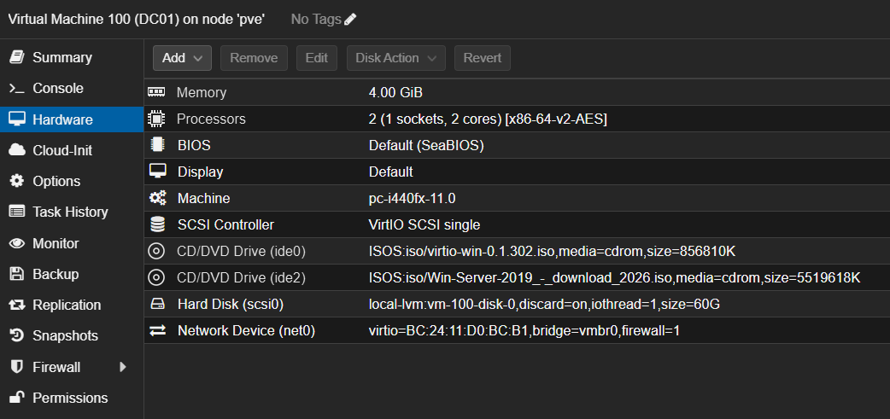
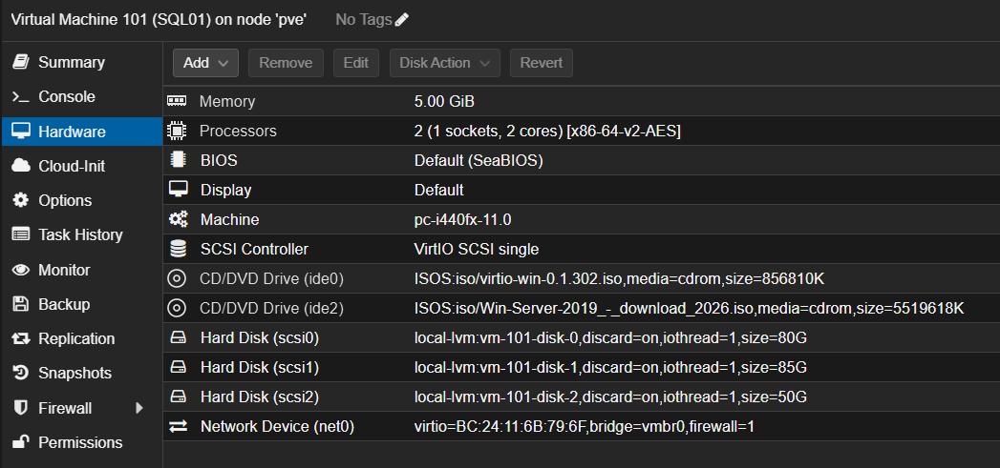

### Configuração final da VM 100 - Servidor Active directory

A VM foi configurada com 2 vCPU, 4 GiB de RAM,
disco de 60 GiB e adaptador de rede associado à vmbr0.

### Configuração final da VM 101 - Servodor do SQL Server

A VM foi configurada com 2 vCPU, 4 GiB de RAM,
disco de 60 GiB e adaptador de rede associado à vmbr0.

